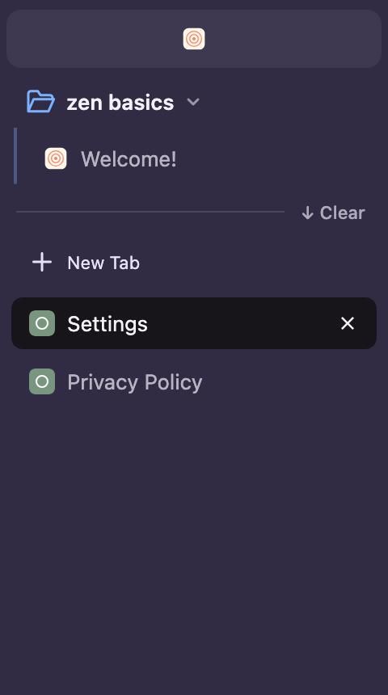

# ZenFX for Firefox

A Zen-inspired Firefox interface using native vertical tabs, folder-style tab groups, a floating address field, and native Split View. Firefox supplies the sidebar’s native colors and header images; folder icons follow their native group colors, and the sidebar stays resizable.

**Tested on Firefox 158 for macOS.** Windows/Linux styling and launchers are experimental. This is an independent customization, not an official Mozilla or Zen Browser product.

## Download

- **[Appearance only](https://github.com/ajshaw0327-sketch/zenfx-firefox/raw/refs/heads/main/dist/ZenFX-Appearance.zip)** — just `userChrome.css` and installation instructions.
- **[Full setup](https://github.com/ajshaw0327-sketch/zenfx-firefox/raw/refs/heads/main/dist/ZenFX-Setup.zip)** — appearance, the four optional scripts, guided installer, and unsigned tab-cleanup source.
- **[Single CSS file](standalone/userChrome.css)** — replace your stylesheet, enable Firefox's custom stylesheets preference, and restart.

Start with [appearance installation](appearance/README.md) or [full setup instructions](START-HERE.md).

## What each part does

| Part | Features | How it runs |
| --- | --- | --- |
| Appearance | Resizable vertical sidebar, theme-aware folder icons, rounded page frame, floating address-field styling, paired split-tab headers without an internal divider, draggable empty sidebar space | `userChrome.css` |
| Floating New Tab search | New Tab opens the real search/address field over the current webpage; Escape cancels; submitting opens a tab | Optional browser script |
| Drag to split | Drag one ordinary tab onto the left or right side of the current page to create native Split View | Optional browser script |
| Tab hierarchy | Favorites as icon tiles, Pinned tabs as full rows, unlabeled ordinary tabs below a Clear control; right-click → Tab priority to change a tab’s section | Optional browser script |
| Compact Mode controls | Button and editable shortcut; the default takes over Firefox's sidebar-toggle binding, Control+Z in the tested macOS build | Optional browser script |
| Tab cleanup | Protect pinned/grouped tabs; close eligible ordinary web tabs after 24 hours of inactivity, with pause, preview, and recovery controls | Separate unsigned WebExtension source |

## Tab hierarchy

Right-click a tab → **Tab priority** → **Favorites**, **Pinned tabs**, or **Today tabs**.

- **Favorites:** icon tiles at the top, with saved per-tab status. They are native pinned tabs and are protected from automatic cleanup.
- **Pinned tabs:** native pinned tabs shown as full rows with their titles; also protected from cleanup.
- **Today tabs:** ordinary unpinned, ungrouped tabs, shown without a section heading. Eligible web tabs use the optional cleanup add-on's 24-hour inactivity rule; native session settings still apply.

Favorites fill a compact icon grid. Pinned rows and group-colored outline folders sit above one divider with **↓ Clear**; **New Tab** and ordinary tabs sit below it. There is no space name or Today heading. **Clear** closes visible ordinary tabs, including ordinary split pairs, while preserving Favorites, pins, folders, and hidden tabs. Firefox’s **Reopen Closed Tab** recovers closed tabs. The collapsed sidebar retains the native icon rail. Separate a native Split View before changing one of its tabs to Favorites or Pinned tabs. [Details and validation](docs/TAB-HIERARCHY.md). [Public Zen styling reference](https://github.com/zen-browser/desktop/blob/dev/src/zen/tabs/zen-tabs/vertical-tabs.css).

This feature requires the **fourth optional script plus the updated CSS and loader**; appearance-only CSS cannot save Favorites, add the priority menu, or make Clear work. Existing installations must update the loader's script list as well as the stylesheet/scripts.

## Start with appearance only

1. Open `about:support` in Firefox and reveal **Profile Folder**. Quit Firefox completely.
2. Back up any existing `chrome/userChrome.css`, then copy the [standalone file](standalone/userChrome.css) there. Create `chrome` if needed.
3. Set `toolkit.legacyUserProfileCustomizations.stylesheets` to `true` in `about:config`, enable native Vertical Tabs, and restart Firefox.

Drag the expanded sidebar's right edge to resize it. Right-click a tab and choose **Add Split View** to display two pages side by side.

For CSS-only Compact Mode, create Boolean preferences `zenfx.compact.top` and/or `zenfx.compact.sidebar`: `true` hides that bar until its edge is hovered, and `false` keeps it visible. When both are enabled, either edge reveals both bars as one shared area; the sidebar stays below the toolbar while you move between them. The sidebar resize handle is available when sidebar Compact Mode is off.

## Keep the scripts across restarts

The four scripts are in [optional-chrome](optional-chrome/). Copying them into `chrome` does not execute them. They need a compatible browser script loader.

The [full setup](START-HERE.md) offers an AutoConfig loader when you explicitly select both your profile and the Firefox application. This writes two files into that application and backs up changed profile files. Python 3.10+ is required; the graphical installer also needs Tk. Existing AutoConfig conflicts are refused.

**The scripts and new-window loading were browser-tested; application-level AutoConfig loading after a complete quit/relaunch has not been verified.** AutoConfig is a Mozilla facility, but this use of private interface APIs is custom scripting and may need repairs after Firefox updates. No application files were modified during development. Standard Firefox extensions cannot run these scripts. See [Mozilla's AutoConfig documentation](https://support.mozilla.org/en-US/kb/customizing-firefox-using-autoconfig).

To change the shortcut, right-click the Compact Mode button → record your combination → **Save**. Choose **Use default → Save** to take over the native sidebar shortcut. Choosing another shortcut, selecting **No shortcut**, or unloading the script restores the native binding.

## Cleanup add-on

The [cleanup companion](companion/README.md) is optional and independent. Its [download](https://github.com/ajshaw0327-sketch/zenfx-firefox/raw/refs/heads/main/dist/ZenFX-Tab-Cleanup-1.0.1-unsigned.zip) is unsigned source. It needs Mozilla signing before permanent installation in ordinary Firefox. It is not installed automatically, and renaming the ZIP to XPI does not sign it.

## Source and verification

- [Modular CSS](chrome/zenfx/) and [complete CSS](standalone/userChrome.css)
- [Scripts and their installation limits](optional-chrome/README.md)
- [Installer, backup, and removal instructions](START-HERE.md)
- [Native theme colors and group-colored folders](docs/THEMES.md)
- [Browser validation and remaining limitations](docs/VALIDATION.md)
- [Build and test instructions](docs/DEVELOPMENT.md)

Firefox profiles, browsing history, local recovery data, credentials, and browsing screenshots are excluded from this repository. The preview above contains only disposable local test tabs.

The Compact Mode settings dialog also has separate **Hide top toolbar** and **Hide sidebar** controls. **Reveal both bars together** keeps the default shared hover area; turn it off for independent edge reveals. CSS-only users can set `zenfx.compact.independent-reveal` to `true` for independent reveals.
