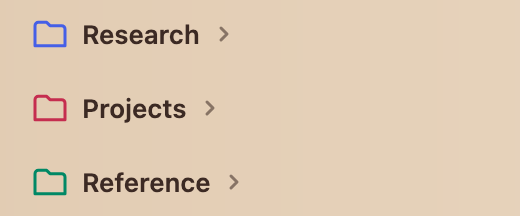
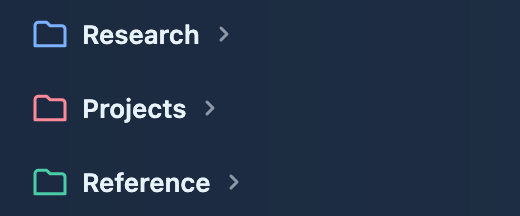

# Native Firefox colors and group-colored folders

ZenFX keeps the Zen-style layout while letting Firefox choose the actual sidebar colors. The launcher has no custom background or text-color override, so native gradients, theme images, frame colors, and text colors paint normally. The selected tab uses Firefox's exact selected fill and text color; the layout removes Nova's painted gradient border without adding another color tint. Unselected Favorites use a subtle native-text tint, and native tab hover colors supply hover feedback.

Firefox 158 Nova treats the vertical-tab launcher as part of the browser frame. A theme's `sidebar` and `sidebar_text` fields apply to sidebar panels; using those older panel colors to paint the launcher would cover the frame image and differ from default Firefox. Themes should define their frame/tab-bar text color, such as `tab_background_text`; omitted fields retain Firefox's own fallback behavior. ZenFX does not invent replacements for missing theme properties.

Outline folder icons use the native `--tab-group-color`, with transparent headers at rest. Changing the group color through Firefox updates the icon immediately. The open/closed folder masks remain opaque; names use the native frame text color. A faint theme-ink edge helps the icon remain identifiable against a similar background. Forced-colors mode follows the system's readable CanvasText instead of forcing a decorative palette.

## Verified on Firefox 158/macOS

In a disposable window, the custom layout was temporarily gated off to measure native colors under the same Firefox theme. With the layout active again, the sidebar container, launcher, body background/image, selected-tab background, and selected text matched that baseline. Cases covered the built-in default theme, explicit light/dark custom themes, and a frame-image theme without sidebar fields. The fixtures explicitly distinguish toolbar, frame, sidebar-panel, and selected-tab colors, so substituting the wrong surface is detectable.

Three native group colors were checked both open and closed in all four themes (24 states), with full icon opacity, real native color equality, and readable theme text. A live blue-to-purple change updated the glyph. Temporary themes and tabs were removed and the original theme restored. This is focused fixture coverage rather than certification of every third-party theme or Firefox version.

[Measurements](validation/native-theme-colors.json) · [Mozilla's current Nova theme mapping](https://blog.mozilla.org/addons/2026/09/29/nova-is-here-what-changes-for-your-firefox-theme/) · [Theme manifest reference](https://developer.mozilla.org/en-US/docs/Mozilla/Add-ons/WebExtensions/manifest.json/theme)
